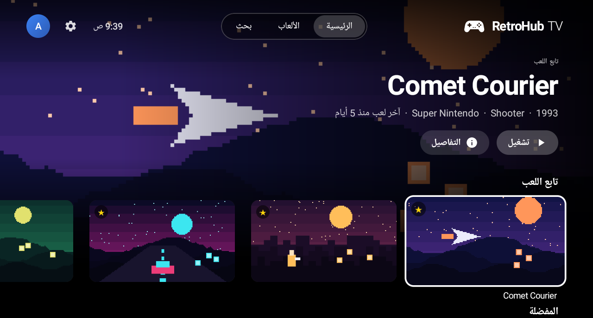
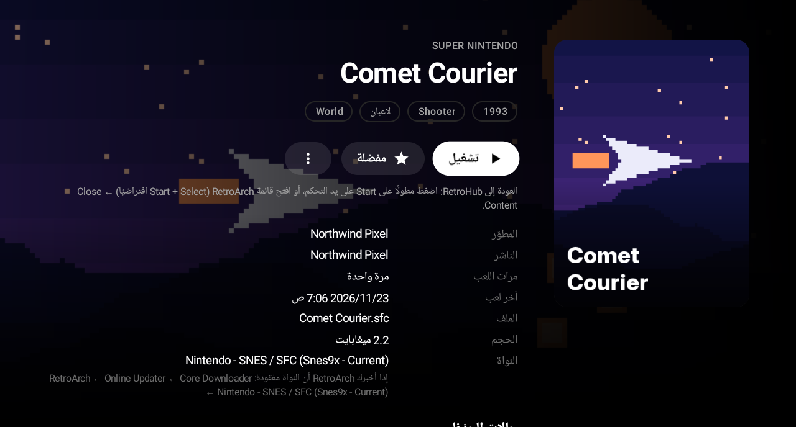
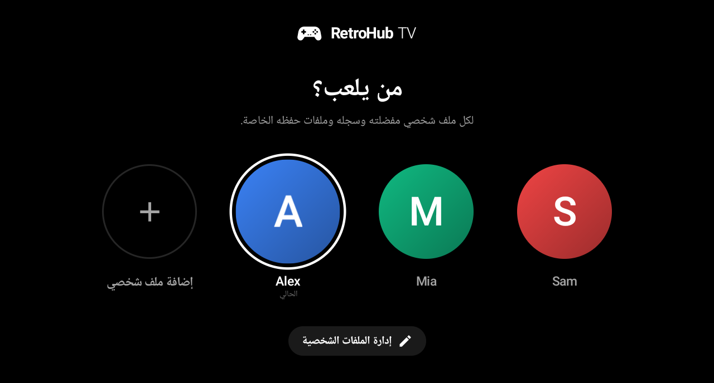
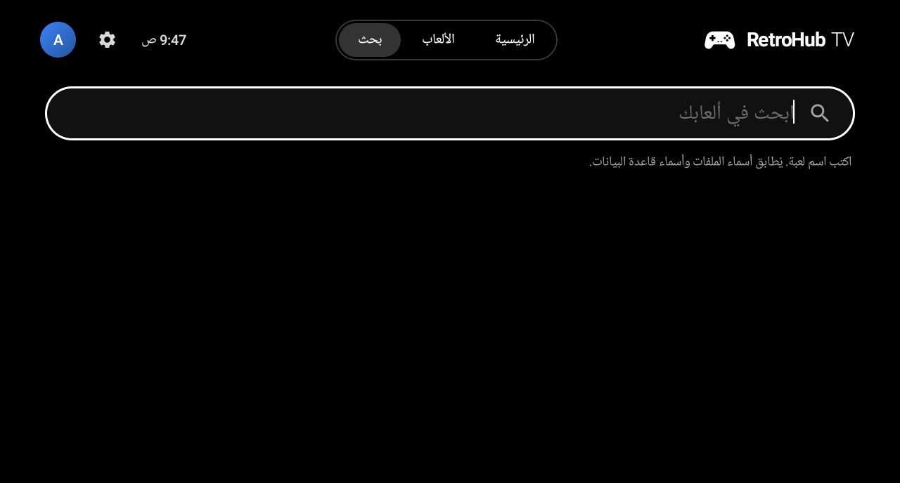
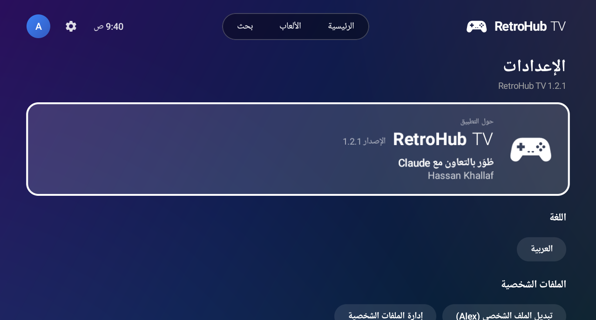
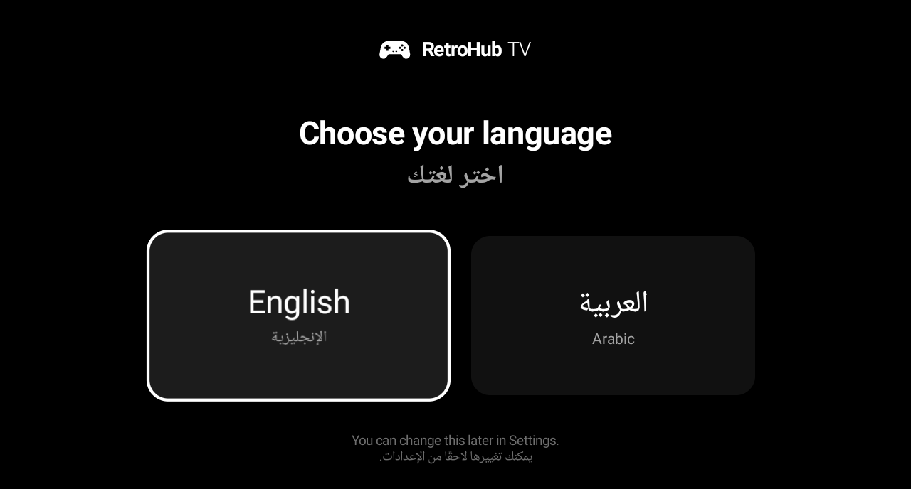

<div dir="rtl">

# RetroHub TV

[English](README.md) | **العربية**

واجهة خفيفة لتشغيل الألعاب على Android TV بأسلوب أجهزة الألعاب، مصممة للأجهزة التي تملك ذاكرة من 1 إلى 2 غيغابايت.

RetroHub TV **واجهة أمامية** فقط: تنظّم مكتبة ألعابك وتشغّلها في تطبيق [RetroArch](https://www.retroarch.com/) المثبت لديك.
لا يحتوي التطبيق على أي محاكي أو نوى أو ألعاب أو ملفات BIOS.

**الإصدار الحالي:** 1.2.1 · **الترخيص:** [GPL-3.0](LICENSE) · **المتطلبات:** Android 5.0 أو أحدث، وتطبيق RetroArch



## لقطات الشاشة

| صفحة اللعبة | من يلعب؟ |
|---|---|
|  |  |
| **البحث** | **الإعدادات** |
|  |  |
| **اختيار اللغة عند التشغيل الأول** | |
|  | |

*الألعاب والصور والاستوديوهات وأسماء اللاعبين الظاهرة في اللقطات خيالية، وأُعدّت خصيصًا لهذه الصور.*

## المزايا

- **الشاشة الرئيسية بأسلوب الرف العلوي:** صورة اللعبة المحددة تملأ الشاشة، مع رفوف للألعاب الأخيرة والمفضلة والأنظمة
- **إعداد تلقائي:** يكتشف RetroArch ومجلد النوى وملف الإعدادات
- **ابحث عن ألعابي:** يستورد قوائم تشغيل RetroArch ويفحص وحدة التخزين، ثم يعرض النتيجة لتراجعها قبل إضافة أي شيء
- **اختيار النواة تلقائيًا:** يستخدم النواة التي يستخدمها RetroArch للنظام، أو نواة موصى بها
- **أغلفة الألعاب وتفاصيلها** من قواعد بيانات libretro المفتوحة، دون الحاجة إلى حساب
- **ملفات شخصية:** لكل لاعب مفضلته وسجله وملفات حفظه وحالات حفظه الخاصة
- **استئناف أو بدء من جديد:** يُحفظ التقدم تلقائيًا عند الخروج من اللعبة
- **العودة إلى RetroHub** من اللعبة باختصار على يد التحكم (الضغط مطولًا على Start افتراضيًا)
- **العربية والإنجليزية:** اختر اللغة عند التشغيل الأول أو من الإعدادات، وتظهر الواجهة العربية بالكامل من اليمين إلى اليسار
- **البحث** وتصفية الألعاب حسب النظام، مع تنقل كامل بأزرار الاتجاهات
- **تصميم موفّر للذاكرة:** قوائم كسولة، وذاكرة صور مؤقتة محدودة، ولا خدمات في الخلفية، مع وضع خفيف

## البدء السريع

1. ثبّت RetroArch وافتحه مرة واحدة، ثم ثبّت النوى التي تريدها من Online Updater.
2. ثبّت RetroHub TV (ابنِه كما هو موضح أدناه، أو استخدم ملف APK من صفحة الإصدارات في هذا المستودع إن وُجد):

<div dir="ltr">

```
adb install -r app-release.apk
```

</div>

3. افتح RetroHub ← **الإعدادات ← التخزين ← منح إذن التخزين**. إذا كان تلفازك يخفي هذه الصفحة:

<div dir="ltr">

```
adb shell appops set --uid com.retrohub.tv MANAGE_EXTERNAL_STORAGE allow
```

</div>

4. إذا كنت تستخدم **إصدار متجر Google Play** من RetroArch، فافتح لعبة واحدة من مجلد ألعابك داخل RetroArch مرة واحدة.
   راجع [سبب ذلك](docs/RETROARCH.md#google-play-edition) (بالإنجليزية).
5. في الشاشة الرئيسية لـ RetroHub، اضغط **ابحث عن ألعابي تلقائيًا**، وراجع القائمة، ثم اضغط **إضافة**.

الشرح الكامل متوفر في [دليل الإعداد](docs/SETUP.md) (بالإنجليزية).

## البناء من المصدر

المتطلبات: Android Studio (أو Android SDK مع المنصة 36) و JDK 17 أو 21.

<div dir="ltr">

```
git clone https://github.com/titaniumgui/RetroHubTV.git
cd RetroHubTV
./gradlew assembleDebug        # app/build/outputs/apk/debug/app-debug.apk
./gradlew assembleRelease      # app/build/outputs/apk/release/app-release.apk
./gradlew testDebugUnitTest lintDebug
```

</div>

على Windows استخدم `gradlew.bat`. لا يعمل Gradle 8.14 على JDK 25، لذا يطلب الملف `gradle/gradle-daemon-jvm.properties`
الإصدار JDK 21. يختار Android Studio الإصدار المناسب تلقائيًا، أما في الطرفية فاضبط المتغير `JAVA_HOME`.

> نوع البناء release موقَّع بمفتاح **debug** المحلي لتسهيل التثبيت اليدوي. اضبط مفتاح توقيع خاصًا بك قبل توزيع ملفات APK.

## التوثيق

الأدلة التفصيلية متوفرة باللغة الإنجليزية:

| الدليل | المحتوى |
|---|---|
| [دليل الإعداد](docs/SETUP.md) | التثبيت والأذونات وإضافة الألعاب والملفات الشخصية والحفظ |
| [التكامل مع RetroArch](docs/RETROARCH.md) | طريقة التشغيل، وتخزين إصدار متجر Play، والنوى، وإعدادات التشغيل |
| [البنية](docs/ARCHITECTURE.md) | تنظيم الشيفرة ونموذج البيانات واللغات والتصميم الموفّر للذاكرة |
| [حل المشكلات](docs/TROUBLESHOOTING.md) | الشاشة السوداء والألعاب والنوى المفقودة وأوامر adb المفيدة |
| [المساهمة](CONTRIBUTING.md) | طريقة العمل وقواعد المشروع، بما فيها الترجمة |
| [سجل التغييرات](CHANGELOG.md) | تاريخ الإصدارات |

## الأجهزة التي جُرّب عليها

| الجهاز | Android | RetroArch | النتيجة |
|---|---|---|---|
| تلفاز TCL الذكي (نظام 32 بت، ذاكرة 2.4 غيغابايت) | 14 | 1.22.2 من Google Play، `com.retroarch.aarch64` | تأكّد تشغيل ألعاب PS1 والاستئناف والخروج |
| محاكي Android TV (x86، ذاكرة 2 غيغابايت) | 11 | 1.22.2، `com.retroarch.ra32` | تأكّد تشغيل NES والحفظ والمعلومات والاكتشاف والواجهة العربية |

لم تُجرَّب بعد إصدارات Android من 5 إلى 10، ولا المكتبات الكبيرة، ولا منتقي مجلدات النظام، ولا معظم الأنظمة المحاكاة.
حدود الذاكرة أهداف تصميمية وليست قياسات على أجهزة حقيقية متعددة. نرحب بتقاريركم.

## الخصوصية

لا يحتوي RetroHub على حسابات أو تحليلات أو إعلانات. طلبات الشبكة الوحيدة التي يرسلها هي تنزيل قواعد بيانات الألعاب وصورها من
`raw.githubusercontent.com` (مشاريع libretro). يمكنك إيقاف التنزيل التلقائي من الإعدادات.

## الشؤون القانونية

لا يتضمن RetroHub TV أي ألعاب أو ملفات BIOS ولا يوفّر روابط لها. استخدم فقط المحتوى الذي يحق لك استخدامه.
هذا المشروع غير تابع لـ Libretro أو RetroArch أو أي شركة لأجهزة الألعاب، ولا يحظى بتأييدها. تُنزَّل صور الألعاب وبياناتها على جهازك من
مشاريع libretro الخارجية، وتبقى ملكًا لأصحابها.

حقوق النشر © 2026 Hassan Khallaf. طُوّر بالتعاون مع Claude. مرخّص بموجب
[رخصة GNU العمومية العامة، الإصدار 3.0](LICENSE). المكونات الخارجية مدرجة في
[docs/ARCHITECTURE.md](docs/ARCHITECTURE.md#third-party-components).

</div>
