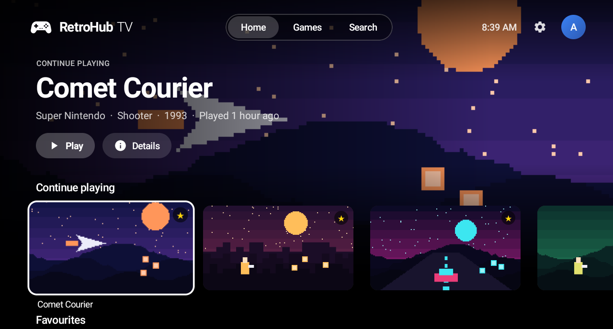
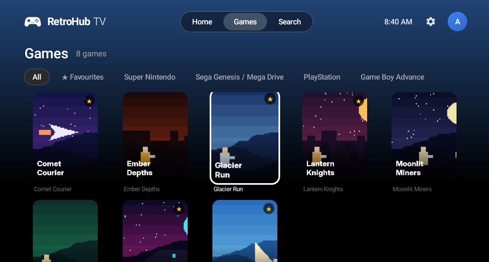
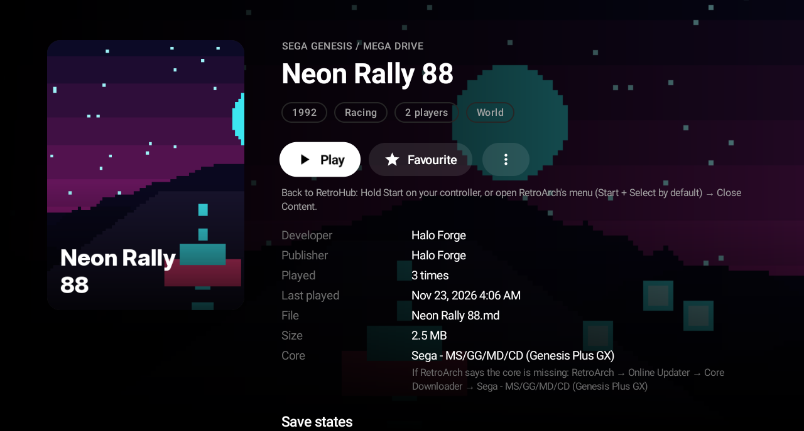
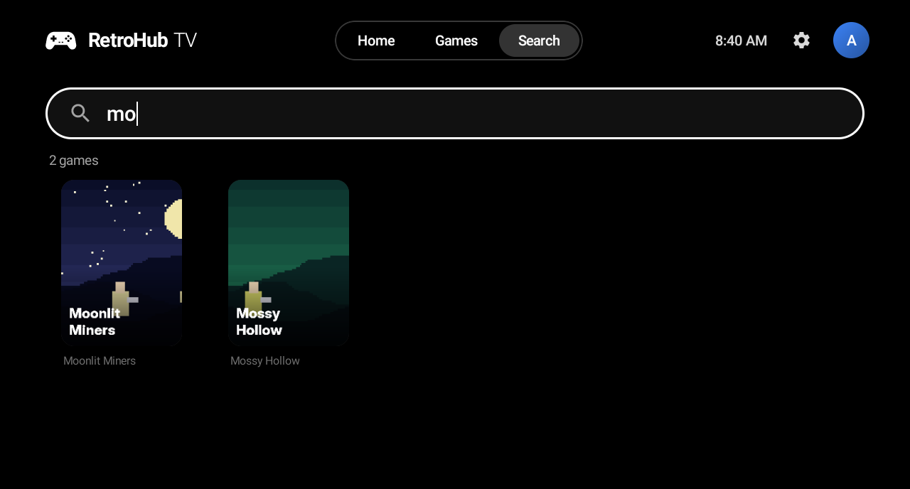
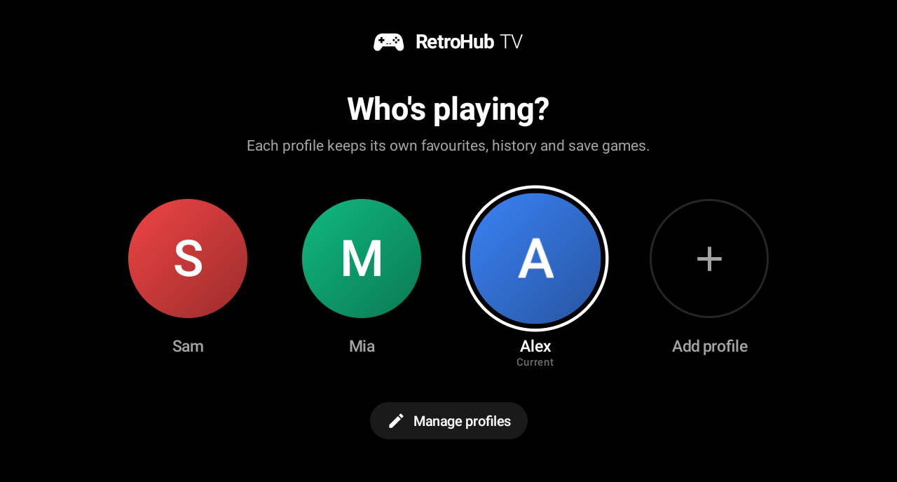
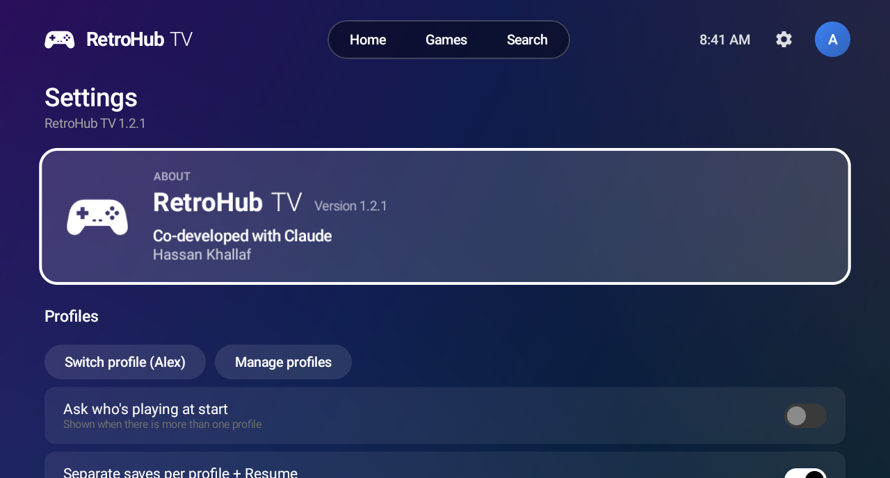

# RetroHub TV

A lightweight, console-style game launcher for Android TV, designed for devices with 1–2 GB of RAM.

RetroHub TV is a **front-end**: it organises your game library and starts games in your existing
[RetroArch](https://www.retroarch.com/) installation. It contains no emulator, cores, games or BIOS files.

**Current version:** 1.2.1 · **License:** [GPL-3.0](LICENSE) · **Requires:** Android 5.0+ and RetroArch



## Screenshots

| Game library | Game details |
|---|---|
|  |  |
| **Search** | **Profiles** |
|  |  |
| **Settings** | |
|  | |

*The games, artwork, studios and player names shown are fictional demo content made for these screenshots.*

## Features

- **Top-shelf home screen:** the focused game's artwork fills the screen, with shelves for recent games, favourites and systems
- **Automatic setup:** detects RetroArch, its core folder and its config
- **Find my games:** imports RetroArch's playlists, scans storage, and lets you review the result before adding anything
- **Automatic core selection:** uses the core RetroArch already uses for a system, or a recommended one
- **Covers and game details** from libretro's open databases, with no account
- **Profiles:** each player has separate favourites, history, saves and save states
- **Resume / Start fresh:** progress auto-saves when you leave a game
- **Return to RetroHub** from a game with a controller shortcut (hold Start by default)
- **Search**, system filters and full D-pad navigation
- **Low-memory design:** lazy lists, bounded image caches, no background services, and a Lite mode

## Quick start

1. Install RetroArch and open it once. Install the cores you want from its Online Updater.
2. Install RetroHub TV (build it as shown below, or use an APK from this repo's Releases page if one is available):

   ```
   adb install -r app-release.apk
   ```

3. Open RetroHub → **Settings → Storage → Grant storage access**. If your TV hides that page:

   ```
   adb shell appops set --uid com.retrohub.tv MANAGE_EXTERNAL_STORAGE allow
   ```

4. If you use RetroArch's **Google Play edition**, open a game from your ROM folder in RetroArch once. See
   [why this is needed](docs/RETROARCH.md#google-play-edition).
5. On RetroHub's Home screen, press **Find my games automatically**, review the list and press **Add**.

The full walkthrough is in the [setup guide](docs/SETUP.md).

## Build from source

Requirements: Android Studio (or the Android SDK with platform 36) and JDK 17 or 21.

```
git clone https://github.com/titaniumgui/RetroHubTV.git
cd RetroHubTV
./gradlew assembleDebug        # app/build/outputs/apk/debug/app-debug.apk
./gradlew assembleRelease      # app/build/outputs/apk/release/app-release.apk
./gradlew testDebugUnitTest lintDebug
```

On Windows, use `gradlew.bat`. Gradle 8.14 can't run on JDK 25, so `gradle/gradle-daemon-jvm.properties`
requests JDK 21. Android Studio picks one automatically; in a terminal, set `JAVA_HOME`.

> The release build type is signed with the local **debug key** for easy sideloading. Configure your own
> keystore before distributing APKs.

## Documentation

| Guide | Contents |
|---|---|
| [Setup guide](docs/SETUP.md) | Installation, permissions, adding games, profiles, saves |
| [RetroArch integration](docs/RETROARCH.md) | Launch contract, Play edition storage, cores, launch config |
| [Architecture](docs/ARCHITECTURE.md) | Code layout, data model, key flows, low-memory design |
| [Troubleshooting](docs/TROUBLESHOOTING.md) | Black screens, missing games and cores, useful adb commands |
| [Contributing](CONTRIBUTING.md) | Development workflow and project rules |
| [Changelog](CHANGELOG.md) | Version history |

## Tested on

| Device | Android | RetroArch | Result |
|---|---|---|---|
| TCL Smart TV (32-bit OS, 2.4 GB RAM) | 14 | 1.22.2 Google Play, `com.retroarch.aarch64` | PS1 launch, resume and exit confirmed |
| Android TV emulator (x86, 2 GB RAM) | 11 | 1.22.2 `com.retroarch.ra32` | NES launch, saves, metadata and discovery confirmed |

Android 5–10, large libraries, the system folder picker and most emulated systems have not been tested yet.
Memory limits are design targets rather than measurements across real hardware. Reports are welcome.

## Privacy

RetroHub has no accounts, analytics or ads. Its only network requests download game databases and artwork from
`raw.githubusercontent.com` (the libretro projects). You can turn automatic downloads off in Settings.

## Legal

RetroHub TV does not include or link to games or BIOS files. Use only content you have the right to use.
This project is not affiliated with or endorsed by Libretro, RetroArch, or any console maker. Game artwork and data
are downloaded on your device from third-party libretro projects and remain the property of their owners.

Copyright © 2026 Hassan Khallaf. Co-developed with Claude. Licensed under the
[GNU General Public License v3.0](LICENSE). Third-party components are listed in
[docs/ARCHITECTURE.md](docs/ARCHITECTURE.md#third-party-components).
